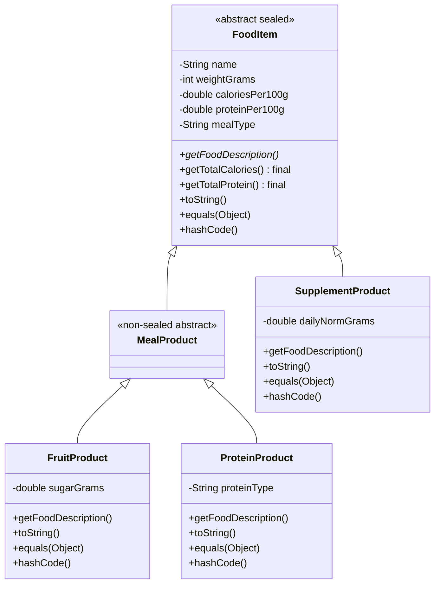

# ЛР6. Ієрархія класів на основі наслідування — щоденник харчування

Продовження ЛР1–ЛР5. Додано ієрархію класів для продуктів харчування,
абстрактний базовий клас, поліморфізм, sealed-ієрархію та композицію.

## Ієрархія класів



## Перевірка «is-a»

- `FruitProduct` **є** `MealProduct`.
- `ProteinProduct` **є** `MealProduct`.
- `MealProduct` **є** `FoodItem`.
- `SupplementProduct` **є** `FoodItem`.

Тому наслідування тут доречне.

## Абстрактний клас

`FoodItem` — абстрактний, бо не можна створити просто «їжу» без конкретного типу.
Метод `getFoodDescription()` абстрактний, бо кожен підклас описує себе по-своєму:

- фрукт — вказує цукор;
- білковий продукт — вказує тип білка;
- добавка — вказує добову норму.

## Три рівні ієрархії

```text
FoodItem → MealProduct → FruitProduct
FoodItem → MealProduct → ProteinProduct
FoodItem → SupplementProduct
```

При створенні `FruitProduct` конструктори викликаються в такому порядку:

1. `FoodItem`;
2. `MealProduct`;
3. `FruitProduct`.

У кожному конструкторі є повідомлення в консоль, тому порядок видно під час запуску.

## super та this

`FruitProduct` використовує `this(...)` для делегування між конструкторами:

```java
public FruitProduct(...) {
    this(..., true);
}
```

А потім викликає конструктор базового класу:

```java
super(name, weightGrams, caloriesPer100g, proteinPer100g, mealType);
```

`super(...)` викликає конструктор батьківського класу. `this(...)`
викликає інший конструктор того самого класу. В одному конструкторі
можна використати лише один із них, і тільки першим оператором.

## Перевизначення та поліморфізм

Кожен підклас перевизначає:

- `getFoodDescription()`;
- `toString()`;
- `equals()`;
- `hashCode()`.

У `Main` створено список базового типу:

```java
List<FoodItem> items = new ArrayList<>();
```

У циклі викликається `getFoodDescription()` та `toString()`.
Java викликає метод фактичного типу об’єкта — це динамічне зв’язування.

## final

Методи `getTotalCalories()` та `getTotalProtein()` зроблено `final`,
бо формули мають бути однаковими для всіх видів їжі. Підкласи не повинні
їх змінювати.

`FruitProduct`, `ProteinProduct` і `SupplementProduct` — `final` класи,
бо вони не мають змістовних підкласів у цій предметній області.

## Sealed

`FoodItem` оголошено як:

```java
public abstract sealed class FoodItem
        permits MealProduct, SupplementProduct
```

Це гарантує компілятору, що безпосередніми підкласами можуть бути лише
`MealProduct` та `SupplementProduct`. Тому `switch` із pattern matching
може бути вичерпним без `default`.

## Композиція замість наслідування

`Product` із попередніх ЛР **має** `FoodItem`, але **не є** `FoodItem`.
Тому між ними композиція, а не наслідування.

Якщо зробити `Product extends FoodItem`, то продукт харчування раптом
отримав би поведінку окремої їжі, хоча насправді є записом у щоденнику.
Це порушило б принцип «is-a».

## Запуск

Потрібен JDK 21 або новіший, бо використовуються sealed classes
та switch із pattern matching.

```bash
mkdir out
javac -encoding UTF-8 -d out *.java
java -cp out Main
```

Запуск тестів:

```bash
java -cp out Lab6Tests
```

## Що збережено з ЛР1–5

- Валідація даних.
- Власні винятки.
- Strategy.
- Factory.
- Observer.
- Adapter.
- Композиція `Product` і `FoodItem`.
